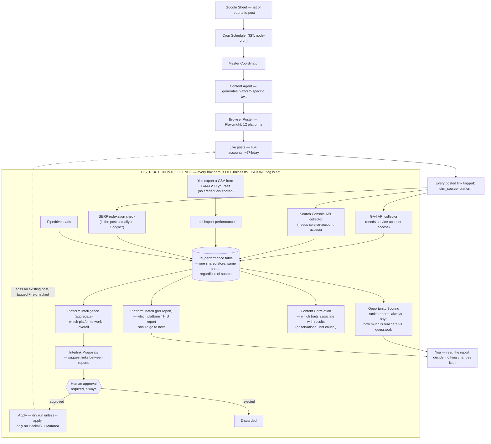

# Architecture — Posting (existing) + Distribution Intelligence (new)

Renders automatically on GitHub. Top box is what already existed; the
bottom box is everything added on `abhinav/distribution-intelligence`
(PR #1) — **off by default**, and it can never change what the top box does.

## How to read it

- **Top row** — unchanged. Sheet → scheduler → content → posting. This PR
  never touches any of these boxes.
- **Bottom box** — everything new. It only *reads* what the top row already
  produced (the posted links and their UTM tags); the only way anything in
  this box ever touches a live post is the single dotted arrow at the
  bottom — a human-approved interlink edit, and only on the two platforms
  verified safe to edit.
- **GA4/GSC has two doors in**, both feeding the exact same table: the
  automated API door (needs access granted) and the manual CSV door (needs
  nothing, since that access isn't being shared with anyone).
- **Shadow mode** (on by default, not drawn above) sits in front of the
  `Apply` box specifically: even an approved suggestion is not applied while
  shadow mode is on.
